# 🚢 CargoPulse Mobile

> **Field Operations Companion** — Aplicación móvil de campo para inspectores de patio, choferes y agentes aduanales en terminales logísticas transfronterizas (México – EE. UU.).

[](.github/workflows/mobile-ci.yml)


---

## 📋 1. Visión Operativa del Producto

**CargoPulse Mobile** es el complemento operativo móvil de la plataforma empresarial web de auditoría de fletes **CargoPulse**. Diseñado específicamente para entornos industriales adversos (patios de maniobras, terminales intermodales y garitas aduaneras sin señal celular garantizada), permite digitalizar de punta a punta la recepción, inspección física y liberación de contenedores de carga.

### Los 4 Pilares Operativos
1. **🔐 Autenticación Segura y Roles:** Login con JWT (`operator@cargopulse.com`), almacenamiento protegido de credenciales en `ISecureStorageService` (`SecureStorage`) y control de acceso basado en roles (`LOGISTICS_OPERATOR`, `FREIGHT_AUDITOR`, `ADMIN`).
2. **📷 Escáner de Alta Velocidad (ZXing):** Lectura instantánea de códigos de barras (Code 128) y códigos bidimensionales (QR / DataMatrix) desde la cámara física del dispositivo, con soporte de linterna/flash, respuesta háptica táctil y búsqueda manual de respaldo.
3. **✍️ Proof of Condition & Firma Digital:** Detección automática de discrepancias de sello fiscal en tiempo real, registro de daños con captura de evidencia fotográfica múltiple (máx. 3 fotos con límites de memoria de 20 MB), captura de firma táctil sobre canvas vectorial (`DrawingView`) y geoposicionamiento GPS satelital.
4. **💾 Arquitectura Offline-First con SQLite:** Persistencia local instantánea en base de datos SQLite (`sqlite-net-pcl`). Cuando no hay red, la inspección se sella localmente con estado `PENDING`. El motor de fondo (`BackgroundSyncEngine`) escucha eventos de conectividad (`ConnectivityChanged`) y sincroniza secuencialmente las inspecciones hacia el backend NestJS con reintentos automáticos y semáforo reentrante.

---

## 🏛️ 2. Arquitectura de Software y Stack Tecnológico

El proyecto está diseñado bajo **Clean Architecture en 3 Capas** y el patrón **MVVM** estricto (`CommunityToolkit.Mvvm`), cumpliendo la política de **Cero Lógica de Negocio en Code-Behind** (`.xaml.cs`).

```mermaid
graph TD
    subgraph UI ["Capa 1: Presentación (Views & XAML)"]
        LoginPage["LoginPage.xaml"]
        DashboardPage["DashboardPage.xaml"]
        ScannerPage["ScannerPage.xaml (ZXing Camera)"]
        ManualEntryPage["ManualEntryPage.xaml"]
        ShipmentDetailPage["ShipmentDetailPage.xaml"]
        InspectionPage["InspectionPage.xaml (DrawingView)"]
        SyncQueuePage["SyncQueuePage.xaml"]
    end

    subgraph ViewModels ["Capa 2: Lógica de Presentación (ViewModels)"]
        LoginVM["LoginViewModel"]
        DashboardVM["DashboardViewModel"]
        ScannerVM["ScannerViewModel"]
        ManualEntryVM["ManualEntryViewModel"]
        ShipmentDetailVM["ShipmentDetailViewModel"]
        InspectionVM["InspectionViewModel"]
        SyncQueueVM["SyncQueueViewModel (IDisposable)"]
    end

    subgraph CoreData ["Capa 3: Núcleo, Red y Persistencia"]
        AuthService["AuthService / ISecureStorage"]
        ShipmentClient["ShipmentApiClient"]
        InspectionClient["InspectionApiClient"]
        SyncEngine["BackgroundSyncEngine (SemaphoreSlim)"]
        LocalRepo["LocalInspectionRepository (SQLite Async)"]
        MediaSvc["MediaService / SignatureService / Geo"]
    end

    subgraph Backend ["Backend NestJS (Existente)"]
        NestApi["NestJS 12 + Prisma ORM (Port 3000)"]
    end

    UI -->|DataBinding & Commands| ViewModels
    ViewModels -->|Inyección de Dependencias| CoreData
    CoreData -->|HTTP JSON / Bearer JWT| NestApi
```



### Tecnologías Clave
* **Framework:** .NET MAUI 9 (`net9.0-android`, `net9.0-ios`, `net9.0-maccatalyst`, `net9.0-windows10.0.19041.0`).
* **MVVM:** `CommunityToolkit.Mvvm` 8.4.2 (Source Generators, `[ObservableProperty]`, `[RelayCommand]`).
* **Controles Visuales:** `CommunityToolkit.Maui` 11.2.0 (`DrawingView`, animaciones, converters).
* **Cámara & Escáner:** `ZXing.Net.Maui.Controls` 0.4.0 (`CameraBarcodeReaderView`).
* **Base de Datos Local:** `sqlite-net-pcl` 1.11.285 + `SQLitePCLRaw.bundle_green` 2.1.11.
* **Testing:** xUnit 2.9.3, `FluentAssertions` 8.3.0, `Moq` 4.20.72.
* **E2E UI Automation:** Maestro CLI (`.maestro/`).

---

## 🌐 3. Topología de Red y Conexión en Desarrollo Local

La aplicación móvil es cliente del backend existente en **NestJS** (`c:\Users\Fer\CargoPulse\apps\api`). Dado que la aplicación corre en entornos aislados (emulador o dispositivo físico), **nunca utilices `localhost` a ciegas en Android**.

### Matriz de Conectividad para Pruebas

| Entorno de Prueba | URL Base Configurada | Instrucciones de Conexión en la Máquina Host |
| :--- | :--- | :--- |
| **Emulador Android (AVD)** | `http://10.0.2.2:3000/api/` | **(Automático)** El emulador Android mapea la IP especial `10.0.2.2` al `localhost` de tu computadora Windows. No requiere configuración adicional. |
| **Celular Físico USB (Recomendado)** | `http://localhost:3000/api/` | Conecta el celular por cable USB con depuración habilitada y ejecuta en terminal: <br>`adb reverse tcp:3000 tcp:3000`<br>Esto redirige las llamadas del teléfono a la PC. |
| **Celular Físico por Wi-Fi** | `http://<IP_LOCAL_PC>:3000/api/` | Conecta PC y celular a la misma red Wi-Fi. Obtén tu IP local con `ipconfig` (ej. `192.168.1.85`). Asegúrate de que NestJS escuche en `0.0.0.0` y que el Firewall permita el puerto 3000. |
| **Red Celular 4G/5G (Túnel ngrok)** | `https://<hash>.ngrok-free.app/api/` | Ejecuta en PowerShell: `ngrok http 3000`. Copia la URL pública generada y configúrala en la app. |
| **App Windows Desktop** | `http://localhost:3000/api/` | **(Automático)** Se conecta directamente en loopback nativo. |

> [!TIP]
> **Cambio de Servidor en Caliente (Runtime Override):** En la pantalla de inicio de sesión de CargoPulse Mobile, encontrarás el botón **`⚙ Cambiar`** debajo del formulario. Puedes pulsar ese botón para ingresar la IP o URL de tu backend en tiempo de ejecución sin necesidad de recompilar la aplicación.

---

## 👤 4. Credenciales y Datos de Prueba del Backend

El backend existente incluye el script `seed.ts` (`npm run seed` en `CargoPulse/apps/api`). Utiliza las siguientes credenciales para realizar pruebas reales:

### Usuarios y Roles Sembrados
| Correo Electrónico | Contraseña | Rol de Operación | Perfil y Acceso |
| :--- | :--- | :--- | :--- |
| `operator@cargopulse.com` | `Password123!` | `LOGISTICS_OPERATOR` | **Perfil de Campo:** Escaneo de contenedores, inspección física y firma digital. |
| `admin@cargopulse.com` | `Password123!` | `ADMIN` | **Administrador General:** Visualización completa de alertas y métricas. |
| `auditor@cargopulse.com` | `Password123!` | `FREIGHT_AUDITOR` | **Auditor Aduanal:** Acceso a bitácora colaborativa y discrepancias de sello. |

### Embarques y Números de Guía para Escaneo
* **Guía Principal de Prueba:** `CP-2026-X9810` (Ruta: Shanghai Port, CN ➔ Los Angeles Gateway, US / Estatus: `CUSTOMS_HOLD`).
* **Guía Transfronteriza:** `MX-TX-99881` (Ruta: Nuevo Laredo ➔ Laredo, TX / Sello declarado: `SEAL-TX-8841-A`).

---

## 🚀 5. Guía de Instalación, Compilación y Ejecución

### Requisitos Previos
* Windows 10/11 con **.NET 9 SDK** (`dotnet --version` >= 9.0.100).
* Workload de .NET MAUI Android instalado:
  ```powershell
  dotnet workload install android
  ```
* Android SDK Platform 34 o 35 y Android Command-Line Tools (`adb`).

### 1. Iniciar el Backend NestJS
En una terminal independiente, levanta el backend existente:
```powershell
cd c:\Users\Fer\CargoPulse\apps\api
npm install
npm run seed     # Opcional: si deseas resetear usuarios y embarques de prueba
npm run start:dev
```
*Verifica que responda en: `http://localhost:3000/api/docs`.*

### 2. Restaurar y Validar Formato en Mobile
```powershell
cd c:\Users\Fer\CargoPulse-mobile
dotnet restore CargoPulse.Mobile.sln
dotnet format --verify-no-changes --verbosity normal
```

### 3. Ejecutar la Suite de Pruebas Unitarias (Headless, 0 Emuladores)
```powershell
dotnet test test/CargoPulse.Mobile.Tests/CargoPulse.Mobile.Tests.csproj
```
*Resultado esperado: **245 pruebas exitosas** en ~450 ms.*

### 4. Compilar y Desplegar en Emulador o Dispositivo
```powershell
# Compilar proyecto Android (Debug)
dotnet build src/CargoPulse.Mobile.csproj -f net9.0-android

# Si pruebas con celular físico por cable USB, habilita el reenvío de puertos:
adb reverse tcp:3000 tcp:3000

# Desplegar e iniciar en el emulador/dispositivo conectado:
dotnet run --project src/CargoPulse.Mobile.csproj -f net9.0-android
```

---

## 🎭 6. Automatización de Pruebas de Interfaz (Maestro E2E)

El proyecto cuenta con una suite declarativa de pruebas de interfaz de usuario con **Maestro**, simulando el recorrido completo del operador en campo.

```text
.maestro/
├── config.yaml                                      # Configuración global de la app
├── suite.yaml                                       # Runner maestro secuencial
└── flows/
    ├── 01_auth_flow.yaml                            # Validación de login y sesión
    ├── 02_manual_search_and_detail_flow.yaml        # Búsqueda de guía y timeline
    ├── 03_inspection_and_signature_flow.yaml        # Inspección, discrepancia y firma
    └── 04_offline_sync_flow.yaml                    # Gestión y sincronización de cola
```

### Ejecutar Suite E2E con Maestro
```powershell
# Ejecutar la suite completa
maestro test .maestro/suite.yaml

# Ejecutar un flujo específico
maestro test .maestro/flows/03_inspection_and_signature_flow.yaml
```
*Para una guía exhaustiva de instalación de Maestro, comandos de atajo y grabación con Maestro Studio, consulta [`docs/MAESTRO_E2E_GUIDE.md`](docs/MAESTRO_E2E_GUIDE.md).*

---

## 📦 7. Empaquetado para Producción (Release Build)

El proyecto incluye optimizaciones de compilación AOT (*Profiled Ahead-Of-Time*) y ofuscación/reducción de tamaño de código con **R8**:
* Reglas de preservación en [`src/Platforms/Android/proguard-rules.pro`](src/Platforms/Android/proguard-rules.pro).
* Compilación y empaquetado optimizado:
  ```powershell
  dotnet build src/CargoPulse.Mobile.csproj -f net9.0-android -c Release
  ```
* El APK optimizado y firmado para distribución interna se genera en:
  `src/bin/Release/net9.0-android/com.cargopulse.mobile-Signed.apk` (~30 MB).

---

## 📂 8. Estructura del Repositorio

```text
CargoPulse-mobile/
├── .github/
│   └── workflows/
│       ├── mobile-ci.yml                 # Pipeline CI de Build, Lint, Test y Artifacts
│       └── e2e-maestro.yml               # Pipeline E2E con emulador Android
├── .maestro/                             # Suite declarativa de pruebas UI E2E
├── docs/
│   ├── MAESTRO_E2E_GUIDE.md              # Manual operativo de pruebas con Maestro
│   └── specs/                            # Los 6 Documentos Sagrados de Fase 0
│       ├── 01_PRD.md
│       ├── 02_TRD.md
│       ├── 03_UI_UX_SPEC.md
│       ├── 04_APPFLOW.md
│       ├── 05_BACKEND_SCHEMA.md
│       └── 06_IMPLEMENTATION_PLAN.md
├── src/                                  # Código fuente de producción (.NET MAUI 9)
│   ├── Core/                             # Handlers, Servicios Base, Interfaces y Constantes
│   ├── Data/                             # Clientes API HTTP, DTOs y SQLite Local Database
│   ├── Platforms/                        # Configuraciones nativas (Android, iOS, Windows)
│   ├── Resources/                        # Fuentes, Iconos y Splash Screen
│   ├── ViewModels/                       # Lógica de presentación pura (CommunityToolkit.Mvvm)
│   ├── Views/                            # Pantallas XAML industriales (Cero code-behind)
│   ├── AppShell.xaml                     # Navegación basada en Shell y rutas dinámicas
│   └── MauiProgram.cs                    # Contenedor de Inyección de Dependencias
├── test/
│   └── CargoPulse.Mobile.Tests/          # 245 Pruebas unitarias headless en xUnit
├── CargoPulse.Mobile.sln                 # Solución principal de .NET
├── MASTER_ENGINEERING_CONSTITUTION.md    # Constitución de Ingeniería v2.2
└── README.md                             # Documentación de entrada y manual técnico
```

---

## ⚖️ Licencia y Propiedad
Proyecto desarrollado exclusivamente por y para **Kevin Fernando Torres Castro**. Todos los derechos reservados.
