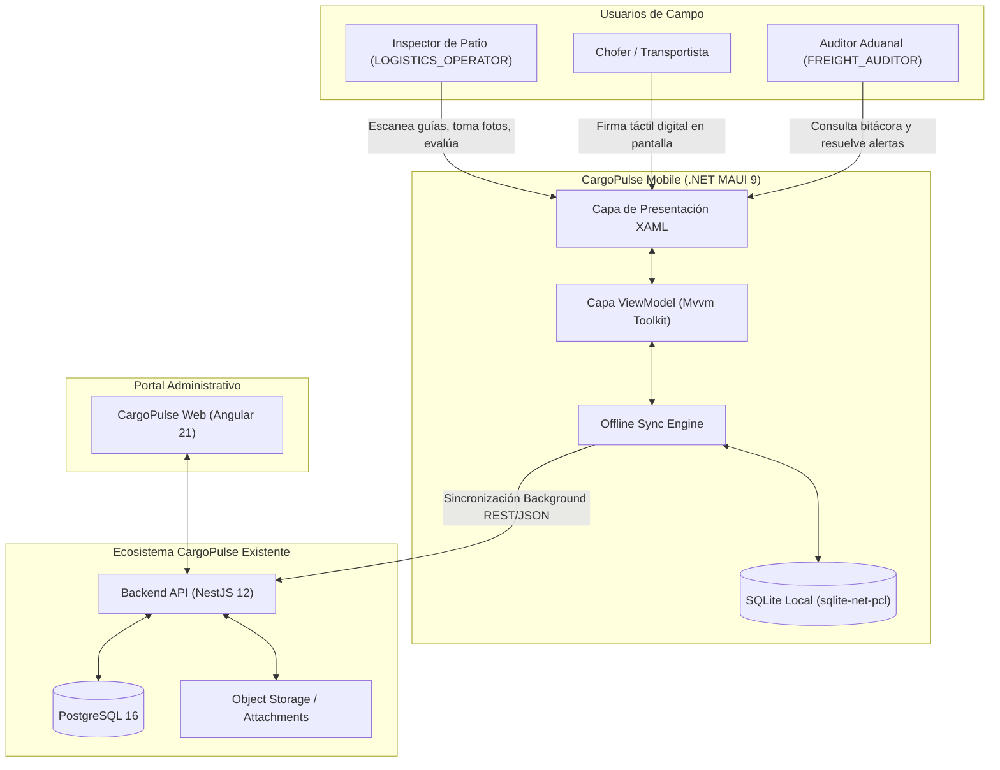

# 02. Technical Requirements Document (TRD)
## CargoPulse Mobile - Field Operations Companion

> **Documento:** `docs/specs/02_TRD.md`  
> **Versión:** 1.0.0  
> **Estado:** En Revisión / Especificación Formal  
> **Fecha:** Octubre 2026  
> **Autor:** Arquitecto Técnico Líder  
> **Proyecto:** CargoPulse Mobile (`CargoPulse-mobile`)  
> **Constitución de Referencia:** `MASTER_ENGINEERING_CONSTITUTION.md` (v2.1)

---

## 1. Casilla de Arquetipo de Proyecto (Obligatoria)

Conforme a la Sección 1.2 y la Sección 5.3 de la Constitución de Ingeniería, se declara formally la siguiente selección inmutable:

- [ ] Web SPA (Angular 21+ Standalone + NestJS)
- [ ] Móvil Nativo (Android Studio / Kotlin + Jetpack Compose + NestJS)
- [x] **Móvil Multiplataforma (.NET MAUI / C# + NestJS)**
- [ ] Multi-Cliente (Web Angular + Móvil Nativo/MAUI + NestJS compartido)

> **Justificación de Selección:**  
> Se opta por **.NET MAUI (C#)** sobre .NET 9 como cliente multiplataforma. Permite una base de código C# unificada y fuertemente tipada para terminales de patio (Android rugged devices como Zebra/Honeywell y smartphones estándar), aprovechando el ecosistema nativo de alto rendimiento: `sqlite-net-pcl` para persistencia offline, `CommunityToolkit.Mvvm` para desacoplamiento estricto de tres capas, `DrawingView` para captura de firma táctil y `ZXing.Net.Maui` para escaneo óptico de hardware por cámara.

---

## 2. Topología del Repositorio y Arquitectura de Sistemas

### 2.1 Enfoque Polyrepo (Repositorios Desacoplados)
Conforme a la Sección 2.1 de la Constitución para stacks heterogéneos (C# en móvil vs. TypeScript en Backend/Web), se confirma la estructura **Polyrepo**:

```text
Estructura de Repositorios Oficiales en GitHub:
├── CargoPulse-mobile/                   # [Repositorio Actual] Cliente Móvil .NET MAUI 9 (C#)
└── CargoPulse/                          # Monorepo Web & Backend (TypeScript)
    ├── apps/
    │   ├── api/                         # Backend NestJS 12 + Prisma + PostgreSQL 16 (EXISTENTE)
    │   └── web/                         # Frontend Web Angular 21 Standalone (EXISTENTE)
    └── packages/                        # Librerías compartidas Web
```

### 2.2 Integración con Backend Existente (Cero Invención de Datos)
El backend de CargoPulse ya está desarrollado y operativo en el repositorio [CargoPulse](https://github.com/kftorresdev/CargoPulse) (`apps/api`).
- **Estrategia de Comunicación:** Consumo de contratos RESTful JSON mediante `HttpClient` en C#.
- **Endpoints Existentes:**
  - `POST /api/auth/login`: Autenticación y emisión de JWT Bearer Token.
  - `GET /api/shipments`: Consulta de lista y detalle de embarques (`/api/shipments/:id` o filtro por tracking).
  - `GET /api/alerts`, `PATCH /api/alerts/:id`: Monitoreo y actualización de incidencias y discrepancias.
  - `GET /api/collaboration/shipment/:id/notes`, `POST /api/collaboration/shipment/:id/notes`: Bitácora colaborativa de 3 niveles.
- **Extensión de Dominio de Inspecciones:**
  - Se formaliza el contrato del nuevo recurso `POST /api/inspections` en el backend NestJS (acompañado del modelo Prisma `Inspection`), el cual recibirá la carga de datos estructurados, referencias de fotos de evidencia y vector/imagen de firma digital capturados en campo.
- **Direcciones Base de Red para Desarrollo:**
  - **Host / Windows Desktop:** `http://localhost:3000/api`
  - **Emulador Android Oficial:** `http://10.0.2.2:3000/api` (redirección al host)
  - **Dispositivo Físico de Patio (Wi-Fi local):** `http://<IP_LAN_HOST>:3000/api`

---

## 3. Diagrama de Arquitectura de Alto Nivel (Modelo C4)

### 3.1 Nivel 1: Diagrama de Contexto de Sistema


### 3.2 Nivel 2: Diagrama de Contenedores de la App Móvil

```mermaid
flowchart LR
    subgraph Presentation["Capa 1: Presentación (Views / XAML)"]
        V_Login["LoginPage.xaml"]
        V_Dash["DashboardPage.xaml"]
        V_Scanner["ScannerPage.xaml"]
        V_Detail["ShipmentDetailPage.xaml"]
        V_Inspect["InspectionPage.xaml (DrawingView)"]
        V_Sync["SyncStatusPage.xaml"]
    end

    subgraph ViewModel["Capa 2: Lógica y Estado (ViewModels)"]
        VM_Login["LoginViewModel"]
        VM_Dash["DashboardViewModel"]
        VM_Scanner["ScannerViewModel"]
        VM_Detail["ShipmentDetailViewModel"]
        VM_Inspect["InspectionViewModel"]
        VM_Sync["SyncStatusViewModel"]
    end

    subgraph CoreServices["Capa 3: Servicios y Persistencia"]
        AuthSvc["AuthService (SecureStorage)"]
        ShipmentSvc["ShipmentApiClient (HttpClient)"]
        InspectionSvc["InspectionApiClient (HttpClient)"]
        SyncEngine["BackgroundSyncEngine (IConnectivity)"]
        LocalRepo["LocalInspectionRepository"]
        SQLiteDB[("SQLite Database: cargopulse_local.db")]
    end

    Presentation -->|DataBinding & Commands| ViewModel
    ViewModel -->|Inyección de Dependencias| CoreServices
    LocalRepo <--> SQLiteDB
    SyncEngine --> LocalRepo
    SyncEngine --> InspectionSvc
```


---

## 4. Stack Tecnológico Detallado y Bibliotecas Oficiales

| Dominio / Componente | Tecnología Seleccionada | Versión / Paquete NuGet | Justificación Técnica |
| :--- | :--- | :--- | :--- |
| **Framework Base** | .NET MAUI | .NET 9.0 (LTS/Current) | Soporte multiplataforma moderno, alto rendimiento de renderizado en Android e iOS. |
| **Patrón Arquitectónico** | MVVM | `CommunityToolkit.Mvvm` (8.3+) | Source Generators en tiempo de compilación (`[ObservableProperty]`, `[RelayCommand]`), cero overhead por reflexión. |
| **Escáner Óptico de Cámara** | Lector QR / Códigos 1D | `ZXing.Net.Maui.Controls` (0.4+) | Decodificación nativa de Code 128, DataMatrix y QR con integración fluida de linterna y cámara. |
| **Firma Táctil Digital** | Pad de Dibujo Vectorial | `CommunityToolkit.Maui` (`DrawingView`) | Captura de trazos táctiles con suavizado y exportación nativa a stream de imagen PNG / Base64. |
| **Base de Datos Local** | SQLite Motor Ligero | `sqlite-net-pcl` (1.9+) + `SQLitePCLRaw.bundle_green` | Persistencia asíncrona rápida (`SQLiteAsyncConnection`), bajo consumo de memoria y soporte multiplataforma garantizado. |
| **Seguridad de Secretos** | Almacenamiento Seguro | `Microsoft.Maui.Storage.SecureStorage` | Utiliza KeyStore en Android y Keychain en iOS para cifrado de tokens JWT y roles. |
| **Monitoreo de Conectividad**| Detección de Red | `Microsoft.Maui.Networking.Connectivity` | Notificaciones en tiempo real vía evento `ConnectivityChanged` para disparo del sync engine. |
| **Cliente HTTP & Serialización**| Comunicación REST | `System.Net.Http.HttpClient` + `System.Text.Json` | Interceptor Bearer Token integrado con `DelegatingHandler` y serialización JSON nativa de alto rendimiento. |
| **Inyección de Dependencias**| DI Container | `Microsoft.Extensions.DependencyInjection` | Registro de Servicios (`AddSingleton`) y ViewModels/Views (`AddTransient`) en `MauiProgram.cs`. |

---

## 5. Regla de Tres Capas y Clean Architecture en C#

Conforme a la Sección 3.2 de la Constitución, se prohíbe taxativamente la lógica de negocio en el code-behind de XAML:

1. **Capa 1: Views (XAML):**
   - El archivo `.xaml.cs` contendrá exclusivamente `InitializeComponent()` y, en casos específicos de hardware, eventos de ciclo de vida (`OnAppearing()`).
   - Cero instanciación de servicios, cero lógica de negocio, cero cálculos matemáticos.
2. **Capa 2: ViewModels (`CommunityToolkit.Mvvm`):**
   - Administran el estado visual reactivo: `IsBusy`, `ErrorMessage`, `ShipmentData`, `IsOffline`.
   - Implementan comandos de acción: `[RelayCommand] Task SubmitInspectionAsync()`.
   - Manejo exhaustivo de estados mediante clases selladas o propiedades observables.
3. **Capa 3: Data & Services (Repositories / ApiClients):**
   - `ShipmentApiClient`: Construye llamadas tipadas hacia el backend NestJS con encabezados `Authorization: Bearer <token>`.
   - `LocalInspectionRepository`: Ejecuta operaciones CRUD sobre `cargopulse_local.db` con `sqlite-net-pcl`.
   - `SyncEngine`: Orquesta la lectura de inspecciones con `SyncStatus = Pending`, la subida secuencial y la actualización atómica a `Synced`.

---

## 6. Requerimientos No Funcionales (NFRs)

### 6.1 Seguridad y Privacidad (OWASP Mobile Top 10)
- **M1: Uso Inseguro de Credenciales:** Prohibido guardar credenciales o tokens en `Preferences` o texto plano. Solo se usará `SecureStorage.Default`.
- **M2: Criptografía Débil:** Toda comunicación con el backend utilizará TLS 1.3 en ambientes de producción (HTTPS). En desarrollo local se restringe a interfaces seguras controladas.
- **M3: Inyección en Datos Locales:** Toda consulta local a SQLite se ejecutará mediante consultas parametrizadas tipadas de `sqlite-net-pcl` para prevenir inyección SQL local.
- **M4: Fuga de Datos en Logs:** Los tokens JWT y firmas digitales no se imprimirán en consola en compilaciones `Release`.

### 6.2 Tolerancia a Fallos y Modo Contingencia (Offline-First)
- **Aislamiento Total de Caídas de Red:** Si una petición HTTP falla por timeout, DNS o falta de señal, la aplicación no colapsa ni muestra alertas no controladas. El registro se almacena en SQLite con marca de tiempo y se programa para reintento automático.
- **Estrategia de Reintentos Exponenciales:** Al restablecerse la conexión, el motor de sincronización reintenta con backoff exponencial (1s, 2s, 4s, 8s hasta 3 intentos) antes de pausar la cola para no saturar la batería ni el ancho de banda.
- **Integridad de Evidencia:** Las imágenes capturadas se guardan en el sistema de archivos local de la app (`FileSystem.AppDataDirectory/evidence/`) y se referencian por ruta local en la base de datos hasta su carga exitosa.

### 6.3 Rendimiento y Consumo de Batería
- **Optimización de Cámara:** El escáner de cámara se desactiva inmediatamente una vez detectado el código para evitar sobrecalentamiento del CPU/GPU y consumo excesivo de batería en el patio.
- **Compresión de Imágenes:** Las fotografías tomadas a 12MP+ son redimensionadas a un ancho máximo de 1920px con compresión JPEG al 80% antes de guardarlas, reduciendo el peso de ~8MB a ~450KB sin pérdida de nitidez en sellos.
