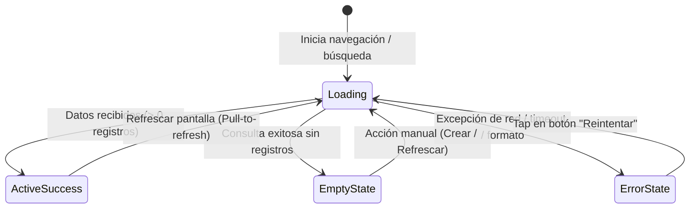

# 03. UI/UX Design System & Mobile Visual Specification
## CargoPulse Mobile - Field Operations Companion

> **Documento:** `docs/specs/03_UI_UX_SPEC.md`  
> **Versión:** 1.0.0  
> **Estado:** En Revisión / Especificación Formal  
> **Fecha:** Octubre 2026  
> **Autor:** Arquitecto Técnico Líder  
> **Proyecto:** CargoPulse Mobile (`CargoPulse-mobile`)  
> **Constitución de Referencia:** `MASTER_ENGINEERING_CONSTITUTION.md` (v2.1)

---

## 1. Principios de Experiencia de Usuario en Campo (Field Ergonomics)

1. **Operación Bajo Luz Solar Extrema:** Interfaces de alto contraste y legibilidad reforzada para operadores bajo el sol del desierto fronterizo (Laredo, Otay, Ciudad Juárez).
2. **Targets Táctiles Industriales ($\ge 48\times 48\text{ dp}$):** Todos los botones, casillas e interruptores están sobredimensionados para permitir su accionamiento por choferes e inspectores usando guantes de trabajo industrial.
3. **Mínima Fricción de Entrada:** Prioridad al escaneo óptico por cámara por encima del tecleo manual en pantallas táctiles sucias o húmedas.
4. **Visibilidad Continua del Estado Offline:** Banner sutil pero inconfundible que indique al operador si está trabajando en modo sin conexión y cuántas inspecciones tiene aseguradas en memoria local pendientes por sincronizar.

---

## 2. Sistema de Diseño (Design Tokens)

### 2.1 Paleta de Colores Corporativa e Industrial
El sistema de color hereda la identidad visual sobria y profesional de CargoPulse Web, adaptada con acentos de alta visibilidad para terminales de carga:

| Token XAML / Estilo | Hex / Color | Rol Semántico / Uso |
| :--- | :--- | :--- |
| `Primary` | `#0F172A` | Azul Marino Profundo (Navy 900) - Fondos de cabecera, barras de navegación. |
| `PrimaryAccent` | `#0284C7` | Azul Cian Industrial (Sky 600) - Botones primarios, acciones activas, visor de escáner. |
| `SecondaryDark` | `#1E293B` | Slate 800 - Superficies de tarjetas, modales y contenedores principales. |
| `SurfaceLight` | `#F8FAFC` | Slate 50 - Fondo de pantalla general en modo diurno. |
| `SurfaceCard` | `#FFFFFF` | Blanco puro - Fondo de tarjetas elevadas con sombra suave. |
| `TextPrimary` | `#0F172A` | Slate 900 - Textos principales, títulos, números de tracking. |
| `TextSecondary` | `#64748B` | Slate 500 - Etiquetas descriptivas, metadatos, timestamps. |
| `Success` | `#16A34A` | Verde Esmeralda (Green 600) - Sello intacto, sincronizado, estado aprobado. |
| `Warning` | `#D97706` | Ámbar Seguridad (Amber 600) - Discrepancia leve, pendiente de sincronización. |
| `Danger` | `#DC2626` | Rojo Carmesí (Red 600) - Sello roto, daño crítico en carga, error de red. |
| `OfflineBanner` | `#475569` | Gris Pizarra (Slate 600) - Franja indicadora de modo sin conexión. |

### 2.2 Tipografía
- **Familia Tipográfica:** Fuente de sistema estándar (Roboto en Android / San Francisco en iOS / Segoe UI en Windows) para máxima velocidad de renderizado nativo.
- **Jerarquía:**
  - `DisplayTitle`: 24sp / Bold (Encabezados de pantalla y tracking number principal).
  - `SectionHeader`: 18sp / SemiBold (Separadores de módulos y títulos de tarjetas).
  - `BodyRegular`: 14sp / Regular (Textos descriptivos, notas, datos de manifiesto).
  - `Caption`: 12sp / Regular (Marcas de tiempo, versiones, subtítulos secundarios).
  - `DataMonospace`: 15sp / Monospace / Bold (Números de contenedor ISO 6346, sellos aduanales y códigos de guía).

### 2.3 Espaciados y Radios de Borde (Layout Spacing)
- **Espaciado Base:** Múltiplos de $4\text{ dp}$ ($4, 8, 12, 16, 24, 32\text{ dp}$).
- **Márgenes de Pantalla:** Margen exterior estándar de $16\text{ dp}$ en smartphone, $24\text{ dp}$ en tablet.
- **Radios de Borde (`CornerRadius`):**
  - Tarjetas y Contenedores: `12`
  - Botones de Acción: `8`
  - Chips / Badges de Estado: `16` (pastilla completa)
  - Pad de Firma Táctil: `10` con borde visible de `2 dp` (`#CBD5E1`).

---

## 3. Inventario de Componentes Atómicos de UI

### 3.1 Botones de Acción Industrial (`CPButton`)
- Altura mínima: `52 dp`.
- Variantes:
  - **Primario (`CPButton.Primary`):** Fondo `PrimaryAccent` con texto blanco negrita e icono Material.
  - **Secundario (`CPButton.Secondary`):** Borde de 2dp con fondo transparente o gris tenue.
  - **Destructivo (`CPButton.Danger`):** Fondo `Danger` para cancelaciones o reportes de alerta crítica.
- Retroalimentación: Cambio de opacidad al presionar y animación suave de carga (`ActivityIndicator` integrado si `IsBusy == true`).

### 3.2 Visor de Escáner con Overlay Táctico (`CPScannerOverlay`)
- Área central recortada transparente con esquinas luminosas en color `PrimaryAccent`.
- Barra roja/azul de barrido vertical animada simulando escaneo activo.
- Botón flotante inferior para encender/apagar linterna (Flashlight toggle).
- Botón superior para conmutar a "Entrada Manual de Guía" en caso de códigos físicos deteriorados.

### 3.3 Pad de Firma Táctil Digital (`CPSignaturePad`)
- Implementado mediante `CommunityToolkit.Maui.Views.DrawingView`.
- Línea guía de referencia punteada con texto "Firme aquí con el dedo o stylus".
- Trazo en color `#0F172A` con grosor de `4 dp` para trazos nítidos.
- Botones de control inferiores:
  - "Limpiar Trazo" (borra el canvas).
  - "Confirmar Firma" (valida que no esté vacío y genera el stream PNG / Base64).

### 3.4 Banner de Conectividad Reactivo (`CPConnectivityBanner`)
- Barra delgada de `32 dp` ubicada debajo de la barra de título o arriba del contenido.
- **Modo Online con Pendientes:** Color Ámbar (`Warning`) con mensaje *"Conectado • 2 inspecciones sincronizándose..."*.
- **Modo Offline:** Color Pizarra (`OfflineBanner`) con icono de nube tachada y mensaje *"Modo Offline • Operando con base de datos local"*.
- **Modo Online Sincronizado:** Oculto automáticamente tras mostrar badge verde durante 3 segundos.

---

## 4. Manejo Obligatorio de los 4 Estados de UI (Constitución Sec. 1.3)

Toda pantalla que cargue información remota o local debe implementar exhaustivamente los siguientes 4 estados:

### 4.1 Estado 1: Cargando (Loading State)
- **Prohibido:** Pantallas en blanco o congelamiento del hilo principal de UI.
- **Implementación:** Skeletons de tarjetas o `ActivityIndicator` con mensaje claro de progreso (*"Buscando embarque en base local y remota..."*). Los botones se deshabilitan para evitar dobles envíos.

### 4.2 Estado 2: Estado Vacío (Empty State)
- **Implementación:** Se presenta una ilustración o icono vectorial alusivo, texto descriptivo y un botón de llamada a la acción directo.
- *Ejemplo en Bandeja de Inspecciones:* Icono de portapapeles vacío, título *"Sin inspecciones pendientes"*, subtítulo *"Todas las unidades asignadas han sido liberadas"* y botón *"Escanear Nueva Unidad"*.

### 4.3 Estado 3: Estado de Error (Error State)
- **Implementación:** Tarjeta con borde rojo tenue (`#FECACA`), icono de alerta, descripción entendible para el operador (sin volcados de stacktrace técnico) y un botón prominente de **"Reintentar Conexión"**.

### 4.4 Estado 4: Estado Exitoso / Activo (Active/Success State)
- Visualización jerárquica limpia con separación de datos del embarque, selector de condiciones y checklist táctil.

---

## 5. Adaptabilidad, Teclados y Safe Areas

1. **Safe Area Insets:** Respeto riguroso de las guías de recorte superior (notch / cámara perforada) y barra inferior de gestos nativa en Android/iOS mediante propiedades `IgnoreSafeArea="False"` o handlers específicos.
2. **Manejo de Teclado Virtual (Soft Input):** Formularios envueltos en `ScrollView` con ajuste de viewport automático para evitar que el teclado cubra los campos de entrada de número de sello o descripción de daño.
3. **Bloqueo de Orientación:** Modo vertical (`Portrait`) forzado para smartphones para facilitar la operación con una sola mano en patio; soporte de orientación libre (`SensorPortrait / SensorLandscape`) únicamente en formato Tablet.
