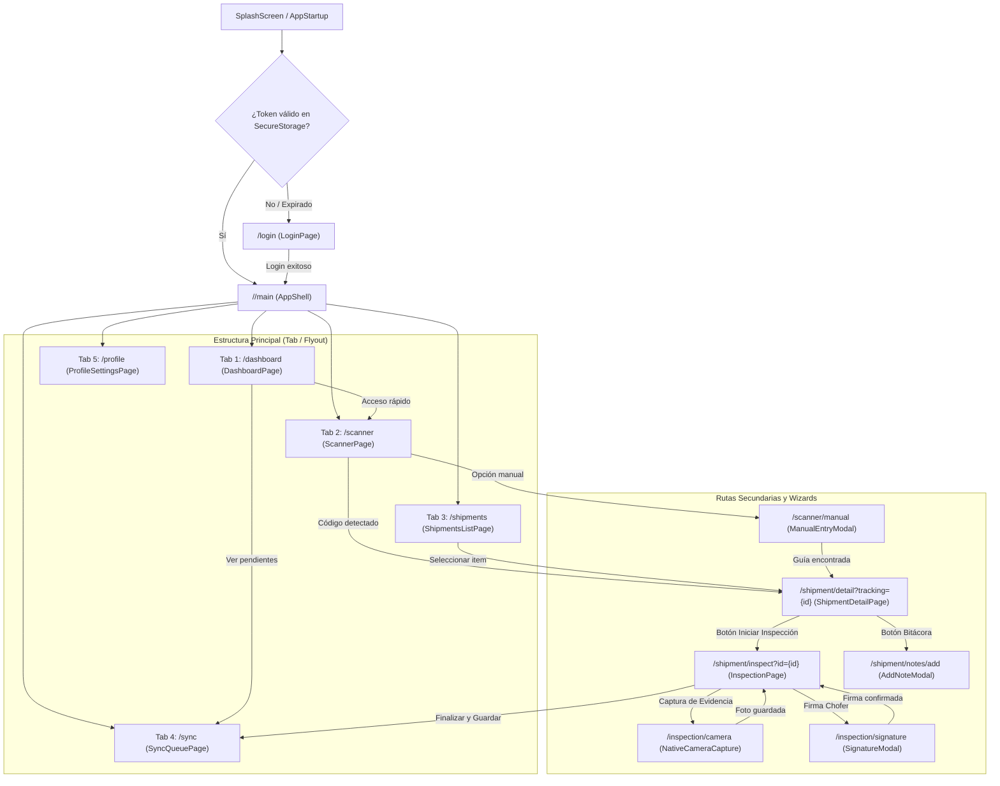
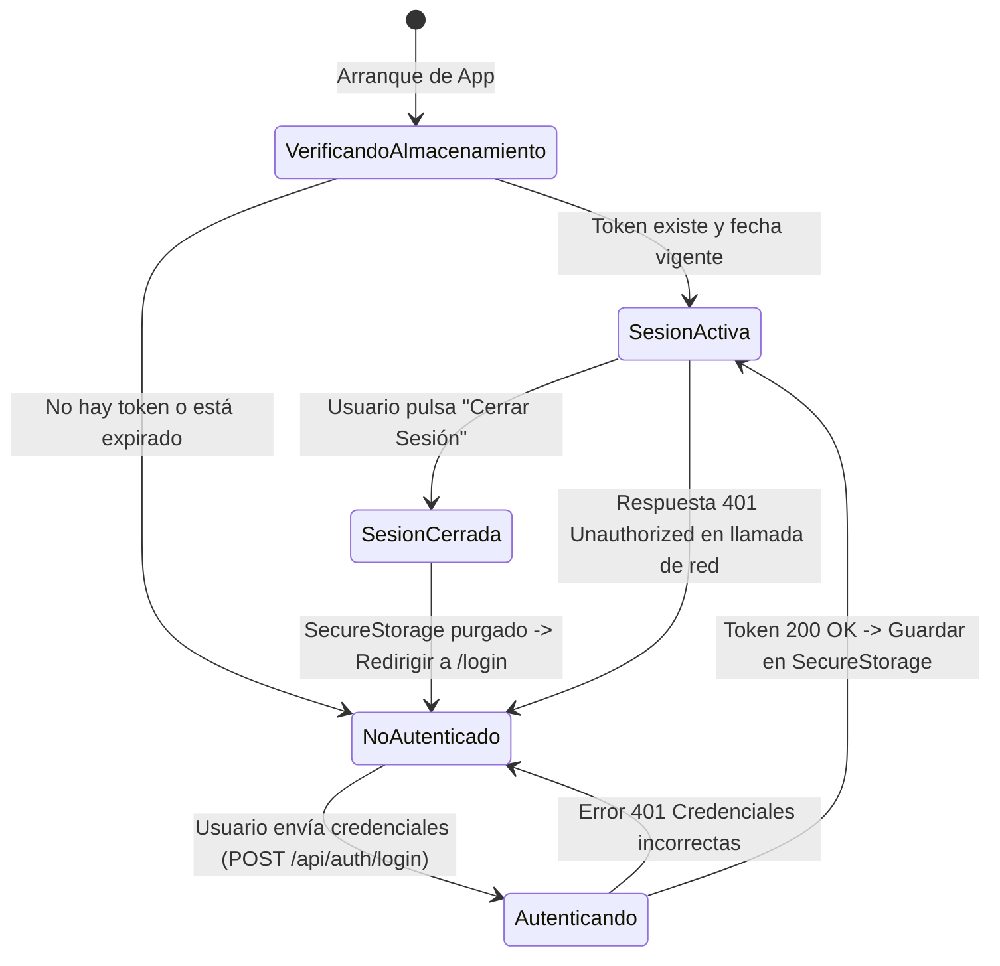
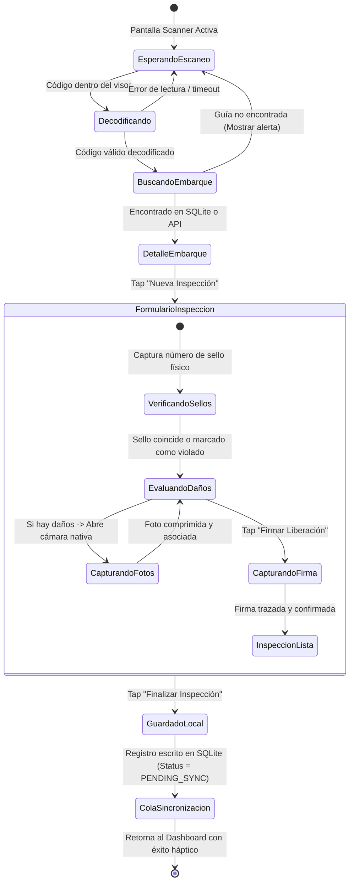
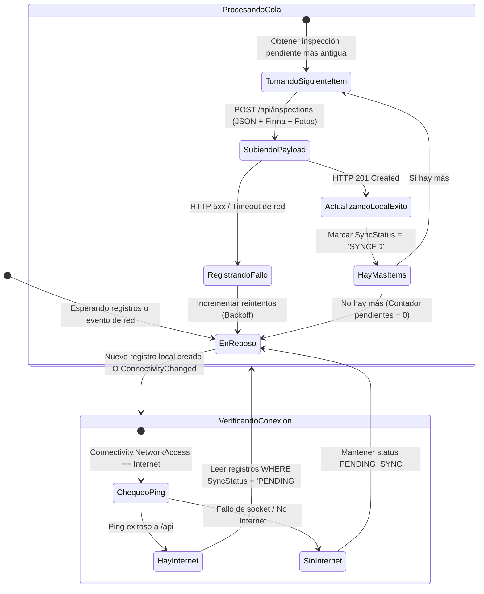

# 04. Appflow & Navigation State Machines
## CargoPulse Mobile - Field Operations Companion

> **Documento:** `docs/specs/04_APPFLOW.md`  
> **Versión:** 1.0.0  
> **Estado:** En Revisión / Especificación Formal  
> **Fecha:** Octubre 2026  
> **Autor:** Arquitecto Técnico Líder  
> **Proyecto:** CargoPulse Mobile (`CargoPulse-mobile`)  
> **Constitución de Referencia:** `MASTER_ENGINEERING_CONSTITUTION.md` (v2.1)

---

## 1. Árbol de Navegación Jerárquico (Shell Navigation)

La navegación móvil se implementa mediante **.NET MAUI Shell**, permitiendo rutas fuertemente tipadas y transiciones limpias:

---

## 2. Matriz de Control de Acceso por Pantalla (RBAC)

Los permisos en la aplicación móvil se gobiernan por el campo `role` contenido en el JWT y resguardado en `SecureStorage`:

| Pantalla / Ruta | `LOGISTICS_OPERATOR` (Inspector / Chofer) | `FREIGHT_AUDITOR` (Agente / Auditor) | `ADMIN` (Supervisor) | Comportamiento si no autorizado |
| :--- | :---: | :---: | :---: | :--- |
| **`/login`** | Permitido | Permitido | Permitido | N/A |
| **`/dashboard`** | Permitido | Permitido | Permitido | Acceso estándar |
| **`/scanner`** | Permitido | Permitido | Permitido | Acceso estándar |
| **`/shipment/detail`** | Permitido | Permitido | Permitido | Acceso estándar |
| **`/shipment/inspect` (Inspección & Firma)** | **Permitido (Lectura/Escritura)** | Solo Lectura | **Permitido (Total)** | Deshabilita inputs de edición para `FREIGHT_AUDITOR`. |
| **`/shipment/notes/add`** | Permitido | Permitido | Permitido | Acceso estándar |
| **`/alerts/resolve` (Cierre de alertas)** | Bloqueado | **Permitido** | **Permitido** | Oculta botón de resolución a Operadores. |
| **`/sync` (Cola y forzado de sync)** | Permitido | Permitido | Permitido | Operadores pueden forzar reintento de sus envíos. |
| **`/settings/admin`** | Bloqueado | Bloqueado | **Permitido** | Redirige a `/dashboard` con mensaje "Acceso restringido". |

---

## 3. Máquinas de Estados de Flujos Críticos

### 3.1 Flujo de Autenticación y Ciclo de Sesión

### 3.2 Flujo Operativo de Escaneo, Inspección y Firma Digital

### 3.3 Flujo del Motor de Sincronización en Segundo Plano (Offline Sync Engine)

