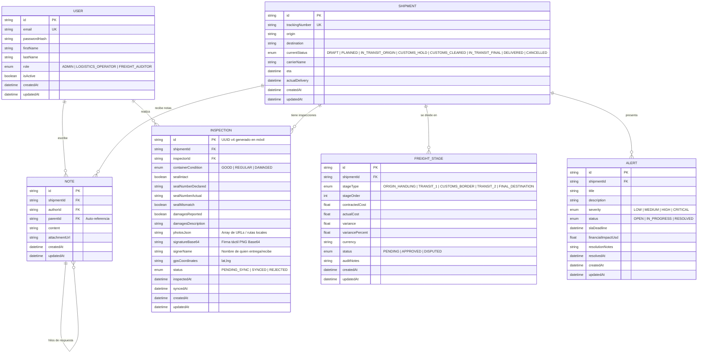

# 05. Backend Schema, API Contracts & DTOs
## CargoPulse Mobile - Field Operations Companion

> **Documento:** `docs/specs/05_BACKEND_SCHEMA.md`  
> **Versión:** 1.0.0  
> **Estado:** En Revisión / Especificación Formal  
> **Fecha:** Octubre 2026  
> **Autor:** Arquitecto Técnico Líder  
> **Proyecto:** CargoPulse Mobile (`CargoPulse-mobile`)  
> **Constitución de Referencia:** `MASTER_ENGINEERING_CONSTITUTION.md` (v2.1)

---

## 1. Integración con el Backend Existente

El backend de CargoPulse ya se encuentra implementado en el repositorio [CargoPulse](https://github.com/kftorresdev/CargoPulse) (`apps/api`), construido sobre NestJS 12 + Prisma ORM + PostgreSQL 16 con modo de contingencia en memoria. 

En esta especificación, formalizamos:
1. Las entidades existentes que la app móvil consulta (`User`, `Shipment`, `FreightStage`, `Alert`, `Note`).
2. La nueva entidad y contrato **`Inspection`**, diseñada para extender el backend y soportar la persistencia y auditoría de pruebas de condición (*Proof of Condition*), fotografías de evidencia y firmas digitales generadas desde el cliente móvil.
3. El esquema relacional local en **SQLite (`sqlite-net-pcl`)** para operación offline.

---

## 2. Diagrama Entidad-Relación (ERD Completo)



---

## 3. Diccionario de Datos: Mapeo Prisma (PostgreSQL) vs. SQLite Local

| Campo Entidad | Tipo Prisma / Postgres | Tipo SQLite Local (C# / `sqlite-net-pcl`) | Nulable | Restricciones / Índices |
| :--- | :--- | :--- | :---: | :--- |
| `Inspection.id` | `String @id @default(uuid())` | `string` (`[PrimaryKey]`) | No | Generado como UUIDv4 en el móvil para garantizar unicidad offline. |
| `Inspection.shipmentId` | `String` (FK -> Shipment) | `string` (`[Indexed]`) | No | Clave foránea al embarque. |
| `Inspection.inspectorId` | `String` (FK -> User) | `string` | No | ID del usuario autenticado que realiza la inspección. |
| `Inspection.containerCondition`| `Enum ContainerCondition` | `string` | No | Valores: `"GOOD"`, `"REGULAR"`, `"DAMAGED"`. |
| `Inspection.sealIntact` | `Boolean` | `int` (0 o 1) | No | `true` si el sello fiscal no presenta manipulación. |
| `Inspection.sealNumberDeclared`| `String` | `string` | No | Número de sello que figura en la guía oficial. |
| `Inspection.sealNumberActual` | `String` | `string` | No | Número de sello físico verificado por el inspector. |
| `Inspection.sealMismatch` | `Boolean` | `int` (0 o 1) | No | `true` si el sello físico difiere del declarado. |
| `Inspection.damagesReported` | `Boolean` | `int` (0 o 1) | No | Bandera para detonar alertas automáticas. |
| `Inspection.damagesDescription`| `String?` | `string` | Sí | Detalle textual de abolladuras, perforaciones o humedad. |
| `Inspection.photosJson` | `String` (JSON serialized) | `string` | No | Serialización JSON con rutas locales o URLs de fotos. |
| `Inspection.signatureBase64` | `String` (Text) | `string` | No | Cadena data-URI o Base64 de la imagen de firma digital. |
| `Inspection.signerName` | `String` | `string` | No | Nombre completo y cargo del firmante. |
| `Inspection.gpsCoordinates` | `String?` | `string` | Sí | Coordenadas `"27.4861,-99.5085"` capturadas al momento. |
| `Inspection.syncStatus` | *(Solo móvil / Metadata)* | `string` (`[Indexed]`) | No | `"PENDING"` o `"SYNCED"`. Filtro para el motor de subida. |
| `Inspection.inspectedAt` | `DateTime` | `DateTime` | No | Estampa de tiempo exacta de la firma en patio. |
| `Inspection.syncedAt` | `DateTime?` | `DateTime?` | Sí | Estampa de tiempo en que el backend confirmó la recepción. |

---

## 4. Contratos de API (Endpoints & DTOs Tipados)

### 4.1 Autenticación: `POST /api/auth/login`
- **Descripción:** Inicio de sesión y emisión de JWT para el operador.
- **Request DTO:**
  ```json
  {
    "email": "inspector@cargopulse.com",
    "password": "Password123!"
  }
  ```
- **Response DTO (HTTP 200 OK):**
  ```json
  {
    "success": true,
    "data": {
      "accessToken": "eyJhbGciOiJIUzI1NiIsInR5cCI6IkpXVCJ9...",
      "user": {
        "id": "c1f7a0b2-38d4-4a25-8390-3498b8d0c72e",
        "email": "inspector@cargopulse.com",
        "firstName": "Fernando",
        "lastName": "Torres",
        "role": "LOGISTICS_OPERATOR"
      }
    },
    "timestamp": "2026-10-17T20:50:00.000Z"
  }
  ```

### 4.2 Consulta de Embarques: `GET /api/shipments` y `GET /api/shipments/:id`
- **Descripción:** Listado o búsqueda directa por ID o número de tracking (vía escáner).
- **Parámetros Query:** `?search=CP-789012` o `?status=IN_TRANSIT_ORIGIN`
- **Response DTO (HTTP 200 OK):**
  ```json
  {
    "success": true,
    "data": [
      {
        "id": "f83a6b21-4d1a-45e7-9d62-c82736bdf1a0",
        "trackingNumber": "CP-789012",
        "origin": "Monterrey Hub, NL, MX",
        "destination": "Laredo Border Yard, TX, US",
        "currentStatus": "CUSTOMS_BORDER",
        "carrierName": "Transportes Frontera Norte S.A.",
        "eta": "2026-10-18T14:00:00.000Z",
        "actualDelivery": null,
        "stages": [
          {
            "id": "e42d7e10-1854-411a-85d1-768a4d7d3d11",
            "stageType": "CUSTOMS_BORDER",
            "stageOrder": 3,
            "status": "PENDING"
          }
        ],
        "alerts": []
      }
    ],
    "timestamp": "2026-10-17T20:50:00.000Z"
  }
  ```

### 4.3 Carga de Inspecciones de Campo: `POST /api/inspections` (Nuevo Contrato)
- **Descripción:** Endpoint seguro para recibir la inspección offline sincronizada desde el móvil.
- **Headers Requeridos:** `Authorization: Bearer <JWT>`, `Content-Type: application/json`
- **Request DTO (`CreateInspectionDto`):**
  ```json
  {
    "id": "3b4f65c1-90a2-4a55-8db7-65d4e2a1b9f0",
    "shipmentId": "f83a6b21-4d1a-45e7-9d62-c82736bdf1a0",
    "containerCondition": "GOOD",
    "sealIntact": true,
    "sealNumberDeclared": "SEAL-MX-98442",
    "sealNumberActual": "SEAL-MX-98442",
    "sealMismatch": false,
    "damagesReported": false,
    "damagesDescription": null,
    "photos": [
      {
        "fileName": "evidence_front_3b4f.jpg",
        "contentType": "image/jpeg",
        "base64Content": "/9j/4AAQSkZJRgABAQEASABIAAD..."
      }
    ],
    "signatureBase64": "data:image/png;base64,iVBORw0KGgoAAAANSUhEUgAA...",
    "signerName": "Juan Carlos Chofer Méndez",
    "gpsCoordinates": "27.4861,-99.5085",
    "inspectedAt": "2026-10-17T20:45:12.000Z"
  }
  ```
- **Response DTO (HTTP 201 Created):**
  ```json
  {
    "success": true,
    "data": {
      "id": "3b4f65c1-90a2-4a55-8db7-65d4e2a1b9f0",
      "shipmentId": "f83a6b21-4d1a-45e7-9d62-c82736bdf1a0",
      "status": "SYNCED",
      "syncedAt": "2026-10-17T20:50:05.120Z",
      "alertCreated": false
    },
    "timestamp": "2026-10-17T20:50:05.122Z"
  }
  ```

### 4.4 Bitácora Colaborativa: `POST /api/collaboration/shipment/:id/notes`
- **Descripción:** Registro de notas rápidas de campo asociadas al embarque.
- **Request DTO:**
  ```json
  {
    "content": "Operador reporta que la unidad ingresó a muelle 4 sin contratiempos.",
    "parentId": null
  }
  ```

---

## 5. DTOs Tipados en C# (.NET MAUI)

Para garantizar la regla de cero `dynamic` y cero tipos débiles (Sección 3.9 de la Constitución), se definen los siguientes modelos en el proyecto móvil:

```csharp
namespace CargoPulse.Mobile.Data.Dtos;

public record LoginRequestDto(string Email, string Password);

public record LoginResponseDto(
    bool Success, 
    UserDataContainer Data, 
    DateTime Timestamp
);

public record UserDataContainer(
    string AccessToken, 
    UserDto User
);

public record UserDto(
    string Id, 
    string Email, 
    string FirstName, 
    string LastName, 
    string Role
);

public record CreateInspectionRequestDto(
    string Id,
    string ShipmentId,
    string ContainerCondition,
    bool SealIntact,
    string SealNumberDeclared,
    string SealNumberActual,
    bool SealMismatch,
    bool DamagesReported,
    string? DamagesDescription,
    List<PhotoUploadDto> Photos,
    string SignatureBase64,
    string SignerName,
    string? GpsCoordinates,
    DateTime InspectedAt
);

public record PhotoUploadDto(
    string FileName, 
    string ContentType, 
    string Base64Content
);

public record InspectionSyncResultDto(
    string Id, 
    string ShipmentId, 
    string Status, 
    DateTime SyncedAt, 
    bool AlertCreated
);
```
